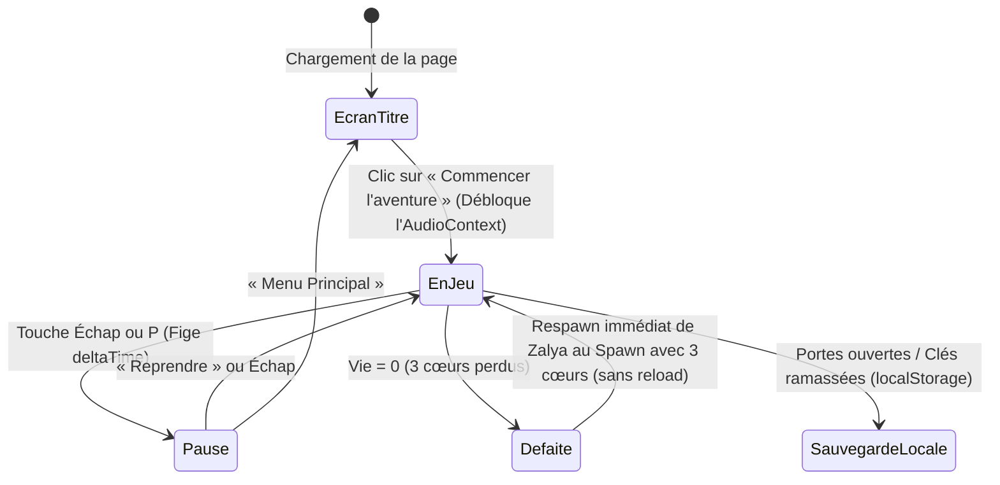

# Game Design Document (GDD) & Feuille de Route — Projet « Lezda »
**Concours Games on Web 2027 — CGI**  
**Thème :** Rétrogaming | **Moteur :** Babylon.js | **Langue :** Français

> [!NOTE]
> **Document vivant & évolutif :** Rien dans ce document n'est gravé dans le marbre. L'architecture, les mécaniques, l'agencement et l'ordre des tâches sont continuellement ajustés et enrichis au fil des playtests, des retours et de nos itérations pratiques.

---

## 1. Vision, Identité, Histoire & Cadrage du Projet

L'objectif est de réaliser un jeu d'action-aventure 3D hommage aux premiers *The Legend of Zelda*, avec un rendu rétro chaleureux, une excellente gestion de la lumière et un game feel soigné et fluide, tout en garantissant une réalisation maîtrisée avant la date limite du concours.

### 1.1 Synopsis & Personnages
* **Zalya (L'Héroïne) :** Le personnage incarné par le joueur. Une aventurière déterminée, vêtue d'une tunique rétro, armée d'une simple épée courte au départ dans la Plaine d'Éveil.
* **Lyo (Le Captif à Secourir) :** Le compagnon / personnage retenu prisonnier. Dès le début dans la plaine, Zalya perçoit des bruits sourds et des appels étouffés provenant de derrière l'imposante porte du sanctuaire nord : c'est Lyo ! Cela donne immédiatement au joueur une motivation narrative claire et urgente dès les premières secondes.
* **Gallen (Le Boss Ennemi) :** L'antagoniste qui garde la chambre du sanctuaire et retient Lyo captif. Un boss puissant et mémorable aux attaques télégraphiées et percutantes que Zalya devra terrasser dans l'arène finale.

### 1.2 Identité & Originalité (Cible : Prix du Jury & Prix le plus original)
* **Nom de code & Titre du Jeu :** `Lezda` est le nom de code interne du dépôt de développement. Pour respecter strictement les règles d'originalité du concours (Article 5.1 du règlement) et éviter tout litige avec Nintendo, les noms créés (**Zalya**, **Lyo**, **Gallen**) posent les bases d'un univers 100 % original. Un titre officiel original sera fixé pour le jeu.
* **Mécanique Originale : La Lumière de l'Épée (« Twist Rétro »)** 
  * L'épée de Zalya est imprégnée d'une **énergie lumineuse ancienne**. Cette mécanique centrale irrigue l'ensemble du gameplay et constitue l'identité distinctive du jeu.
  * **Mode Torche (maintien `Shift` ou clic droit) :** Zalya brandit son épée pour émettre une **aura lumineuse continue** autour d'elle. Éclaire les zones sombres, révèle les éléments cachés, repousse et affaiblit les créatures d'ombre.
  * **Frappe Lumineuse (attaque standard) :** Chaque coup d'épée projette un **flash de lumière** bref qui endommage et illumine la zone d'impact.
  * **Jauge de Lumière (ressource limitée) :** L'énergie lumineuse se **consomme** dans l'obscurité et lors des attaques lumineuses, et se **recharge** à la lumière naturelle (soleil de la plaine, faisceaux lumineux dans les donjons, cristaux réfracteurs). Affichée dans le HUD.
  * **Interactions clés :** Zones d'obscurité dans les donjons (visibilité réduite sans l'épée levée), ennemis d'ombre ne pouvant être touchés que sous la lumière, mécanismes anciens (cristaux, miroirs, dalles photosensibles) réagissant à la lumière de l'épée, boss Gallen manipulant les ténèbres.
  * **Lien Babylon.js :** `PointLight` dynamique attachée au mesh de l'épée, `GlowLayer` pour l'aura, `ShadowGenerator` ciblé pour les ombres significatives. Budget GPU maîtrisé : une seule lumière dynamique pour l'épée, les autres sources restent statiques.
  * Cette mécanique est introduite **dès la plaine** (l'épée brille subtilement au soleil, réagit à l'obscurité de la caverne) et devient progressivement centrale dans les donjons et le combat de boss.

### 1.3 Piliers de Conception & Architecture Technique
* **Game Feel & Plaisir Immédiat :** Avant de créer des dizaines de salles, le simple fait de se déplacer dans la zone de base, de trancher des buissons et de manier son épée doit être dynamique, propre et satisfaisant à 60 FPS.
* **Scène 3D Unique Continue (Monde d'un seul tenant) :**
  * L'ensemble du jeu (plaine extérieure, caverne, sanctuaire et arène de Gallen) coexiste au sein d'**une seule et même scène Babylon.js**.
  * Les salles intérieures sont disposées aux abords de la plaine, reliées par des couloirs de transition naturels.
  * **Avantages majeurs :** Zéro écran de chargement, zéro destruction/recréation lourde, gestion de mémoire constante, transition ultra-fluide.
  * **Gestion des zones :** Les salles et zones inactives sont gérées par activation/désactivation (`mesh.setEnabled(false)`) et non par `scene.dispose()`. L'ensemble des meshes reste chargé mais seules les zones actives consomment du temps de rendu. Cette approche évite les fuites mémoire liées à des cycles dispose/recreate.
* **UI Ultra-Légère en Overlay HTML/CSS Pur :**
  * Superposée directement au `<canvas>` 3D.
  * Pas d'embarquement de `@babylonjs/gui` (~1.5 Mo économisés sur le bundle).
  * Textures pixel-art nettes (`image-rendering: pixelated`), typographie rétro lisible et responsive natif.
  * **Immersion Console : Pas de bouton plein écran visible**, afin de préserver l'authenticité de l'écran rétro sans boutons modernes parasites (le canvas s'adapte élégamment à la fenêtre du navigateur ; la touche standard `F11` reste disponible si le joueur souhaite le plein écran).
* **Conformité stricte :** 100 % en français, 100 % Babylon.js, zéro dépendance non libre, zéro élément sous copyright.

---

## 2. Structure Globale du Monde & Déroulement du Jeu

```text
               +-----------------------------------+
               |       PORTE DU BOSS (Fermée)      |
               | Des bruits résonnent... C'est Lyo!|
               |     Nécessite la Clé du Boss      |
               +-----------------+-----------------+
                                 |
                                 v
               +-----------------------------------+
               |        [CHAMBRE DE GALLEN]        |
               | Boss Gallen + Sauvetage de Lyo    |
               |       -> VICTOIRE & MONDE LIBRE   |
               +-----------------------------------+
                                 ^
                                 |
+----------------------+   +-----+-----+   +----------------------+
|    [CHEMIN 2]        |<--|  PLAINE   |-->|     [CHEMIN 1]       |
| Sanctuaire des Ruines|   | D'ÉVEIL   |   | Caverne du Gardien   |
| (Fermé au départ)    |   |  (HUB)    |   | (Ouvert au départ)   |
| Porte débloquée par  |   +-----------+   | Combat basique,      |
| la Clé simple        |                   | énigme interrupteur, |
| Ennemis avancés      |   Zalya + Épée    | Récompense :         |
| Récompense :         |   3 cœurs         | Clé simple           |
| Clé du Boss          |                   +----------------------+
+----------------------+
```

### 2.1 La Zone de Départ : La Plaine d'Éveil (Hub Central)
* Un espace extérieur verdoyant de taille modeste, style low-poly rétro, avec une **bonne gestion des lumières** (soleil chaud, ombres douces ou blob-shadows, ambiance lumineuse).
* Zalya commence immédiatement avec son **épée courte**.
* Présence de buissons / hautes herbes à découper avec retours visuels (possibilité de trouver un cœur pour se soigner).
* Trois passages bien visibles :
  1. **Chemin 1 (Est) : Ouvert immédiatement.** Concrétisé par une arche naturelle ou l'entrée d'une petite caverne.
  2. **Chemin 2 (Ouest) : Fermé par une grille de bronze.** Nécessite la *Clé simple*.
  3. **Chemin 3 (Nord) : Fermé par une imposante porte de pierre sculptée.** À l'approche, Zalya entend des bruits derrière le battant : Lyo y est prisonnier ! Nécessite la *Clé du Boss*.

### 2.2 Chemin 1 : La Caverne du Gardien (Apprentissage & Clé 1)
* **Objectif :** Apprendre à frapper, esquiver, interagir et **découvrir la lumière de l'épée**.
* **Ambiance Lumière :** La caverne est **plongée dans une semi-obscurité**. Dès l'entrée, l'épée de Zalya commence à luire faiblement, introduisant naturellement le Mode Torche au joueur. Des faisceaux de lumière naturelle percent depuis des fissures au plafond (points de recharge de la jauge).
* **Ennemis :** 2 à 3 gelées/blobs sautillants, lents et faciles à anticiper. Certains sont des **blobs d'ombre** qui ne deviennent vulnérables que lorsqu'ils sont éclairés par l'épée (tutoriel de la mécanique de lumière).
* **Énigme :** Un interrupteur caché dans l'obscurité, révélé uniquement par la lumière de l'épée. Un bloc à pousser sur une dalle photosensible pour ouvrir une herse.
* **Récompense dans le coffre :** La **Clé simple**, qui ouvre la porte du Chemin 2.

### 2.3 Chemin 2 : Le Sanctuaire des Ruines (Défi & Clé du Boss)
* **Objectif :** Valider les compétences de combat, de positionnement et **la gestion de la jauge de lumière**.
* **Ambiance Lumière :** Le sanctuaire est plus vaste et plus sombre que la caverne. Les cristaux réfracteurs au mur amplifient la lumière de l'épée lorsque Zalya s'en approche, créant des cônes de lumière tactiques. La jauge de lumière se consomme plus vite ici, forçant le joueur à optimiser ses déplacements entre les zones éclairées.
* **Ennemis :** Serviteurs de Gallen — **créatures d'ombre** (gardes spectraux ou automates corrompus) avec attaques télégraphiées. Ils sont plus résistants dans l'obscurité et affaiblis/ralentis sous la lumière de l'épée.
* **Piège / Obstacle :** Dalles piégées visibles uniquement sous la lumière, couloirs d'ombre où la jauge se vide rapidement.
* **Récompense dans le coffre :** La **Clé du Boss** (Clé d'Or).

### 2.4 Chemin 3 : L'Arène de Gallen, Sauvetage de Lyo & Victoire
* **Arène fermée :** La porte se referme derrière Zalya une fois entrée. Lyo est visible au fond de la salle (dans une cage suspendue ou derrière un champ d'énergie rétro), émettant une faible lueur qui guide le regard.
* **Le Boss : Gallen (Maître des Ténèbres) :**
  * Barre de vie dédiée affichée en haut de l'écran.
  * **Mécanique de lumière centrale :** Gallen manipule les ténèbres. Il peut **éteindre les sources de lumière** de l'arène, plongeant la salle dans le noir. Zalya doit utiliser son épée pour le **localiser et l'illuminer**, le rendant vulnérable.
  * **Pattern lisible en 3 temps :**
    1. Gallen éteint la lumière et charge/attaque depuis l'obscurité (attaque télégraphiée par un son/indice visuel).
    2. Zalya utilise le Mode Torche pour le révéler → phase de vulnérabilité où elle peut lui porter 2 ou 3 coups d'épée lumineux.
    3. Gallen se téléporte, réinitialise l'obscurité et prépare sa prochaine attaque.
  * 3 à 5 phases de frappe nécessaires pour le vaincre. À mesure qu'il perd de la vie, les phases d'obscurité s'allongent et la jauge de lumière de Zalya est davantage mise sous pression.
* **Victoire & Sauvetage :**
  * Défaite de Gallen : explosion de particules lumineuses rétro, la lumière revient dans l'arène, libération de Lyo.
  * Dialogue court de retrouvailles chaleureuses entre Zalya et Lyo.
  * Apparition d'un grand réceptacle de cœur.
  * **Pas de fin bloquante :** Le monde reste entièrement explorable après la victoire, les zones autrefois sombres sont désormais éclairées (récompense visuelle), permettant de continuer à parcourir la plaine et les sanctuaires avec Lyo en sécurité.

---

## 3. Flux des Menus, Audio & Gestion de la Défaite



1. **Écran Titre (Menu Principal Rétro) :**
   * **Nécessité technique :** Débloque l'`AudioContext` conformément aux restrictions des navigateurs (Chrome/Safari interdisent l'audio avant interaction).
   * Contenu : Titre du jeu, bouton « Commencer l'aventure », panneau de rappel des « Commandes », bascule « Son : Activé / Désactivé ».
2. **Menu Pause (Touche `Échap` ou `P`) :**
   * Met instantanément en pause la boucle logique (`deltaTime = 0`).
   * Propose « Reprendre », « Commandes », « Réinitialiser », réglage sonore.
3. **Gestion de la Défaite (Game Over & Respawn) :**
   * Lorsque les cœurs tombent à 0 : petite animation de chute de Zalya, son de défaite rétro, fondu au noir court (~1s).
   * **Réapparition immédiate au point d'apparition de la plaine** avec la barre de vie restaurée (3 cœurs). Zéro rechargement lourd de la page web.
4. **Sauvegarde Légère de Sécurité (`localStorage`) :**
   * Mémorisation discrète de l'état de progression (portes déverrouillées, clés en poche) pour ne rien perdre en cas de rafraîchissement accidentel (`F5`).

---

## 4. Plan Complet & Détaillé : La Plaine de Base (Hub Central)

Afin de garantir une qualité irréprochable et un game feel optimal, le développement initial se concentre **exclusivement sur la réalisation complète et soignée de la Plaine d'Éveil**. Tout doit y être propre, fluide, beau et conforme aux meilleures pratiques Babylon.js avant d'attaquer les donjons.

```text
       [Porte du Boss - Bruits de Lyo] (Nord)
                         |
[Grille] ----------- (PLAINE) ----------- [Arche Ouverte] (Est)
(Ouest)                  |
                     [Spawn]
              (Zalya, Panneau, Épée)
```

---

### Phase 1 : Socle Technique, Moteur & Architecture Propre
* **Objectif :** Poser les bases du code, le pipeline de build Vite et la scène 3D unique continue sans dette technique.
* **Actions :**
  * Initialisation de Vite avec template standard (HTML5 / ES Modules).
  * Installation ciblée de `@babylonjs/core` (UI gérée en overlay HTML/CSS sans librairie superflue).
  * Structure du code modulaire dans `src/` :
    * `src/main.js` : Bootstrap, gestion du canvas, cycle de vie.
    * `src/core/` : `GameManager`, `InputManager`, `AudioManager`, `SaveManager` (`localStorage`).
    * `src/rendering/` : `CameraManager`, `LightingManager`.
    * `src/world/` : `LevelManager`, `EnvironmentManager`.
    * `src/entities/` : `Player` (Zalya), `Weapon`, `Props`.
    * `src/ui/` : `UIManager` (overlay HTML/CSS : HUD, menus, dialogues).
  * Boucle de jeu robuste découplée du framerate via `deltaTime` plafonné (`Math.min(dt, 0.05)`).
  * Canvas plein écran adaptatif avec redimensionnement dynamique réactif (`engine.resize()`).
  * Compteur de performances discret (FPS et temps de frame) visible uniquement en mode développement (`import.meta.env.DEV`).

---

### Phase 2 : Rendu Rétro, Caméra & Système de Lumière
* **Objectif :** Créer immédiatement une identité visuelle attrayante, chaleureuse et lisible, et **poser les bases du système de lumière de l'épée**.
* **Actions :**
  * **Caméra Zénithale / Isométrique :**
    * Vue plongeante 3/4 rétro (angle fixe ~45°).
    * Suivi lissé de Zalya par interpolation (`Vector3.Lerp`) pour éliminer toute saccade.
    * Limitation des mouvements de caméra aux bornes de la plaine (pas de vide hors-champ).
  * **Éclairage Statique & Ombres :**
    * Lumière directionnelle principale (soleil chaud légèrement doré) projetant des ombres douces ou rétro.
    * Lumière hémisphérique d'appoint (bleutée / ciel doux) pour déboucher les zones d'ombre sans perte de lisibilité.
    * Ombres maîtrisées : blob-shadows rétro sous le joueur pour un coût GPU minime. Réserver le `ShadowGenerator` exclusivement pour la lumière dynamique de l'épée (budget d'une seule shadow map dynamique).
  * **Système de Lumière de l'Épée (Mécanique Centrale) :**
    * `PointLight` dynamique attachée au mesh de l'épée de Zalya, avec portée et intensité variables selon la jauge de lumière.
    * `GlowLayer` globale pour l'aura lumineuse rétro autour de la lame et des objets lumineux (cristaux, cœurs, coffres).
    * Budget GPU strict : **une seule lumière dynamique** (l'épée). Toutes les autres lumières (soleil, torches de décor, faisceaux) sont statiques ou précalculées.
    * Système de jauge de lumière : variable flottante (0.0 → 1.0) décrémentée en zone sombre et lors des frappes lumineuses, incrémentée en zone éclairée. L'intensité/portée de la `PointLight` suit linéairement cette jauge.
  * **Atmosphère & Couleurs :**
    * Léger brouillard de distance (`scene.fogMode = Scene.FOGMODE_EXP2`) teinté aux couleurs de l'horizon pour apporter de la profondeur.
    * Réglage du pipeline de textures : forcer le filtrage le plus net (`Texture.NEAREST_SAMPLINGMODE`) pour toutes les textures rétro pixel-art.

---

### Phase 3 : Zalya, Contrôles Fluides & Déplacement
* **Objectif :** Assurer une prise en main immédiate, nerveuse et ergonomique de l'héroïne.
* **Actions :**
  * **Visuel de Zalya :**
    * Modèle low-poly stylisé original (silhouette rétro lisible, tenue d'aventurière colorée, épée courte au côté).
  * **InputManager multi-disposition :**
    * Prise en charge native sans configuration requise des touches **ZQSD (AZERTY)**, **WASD (QWERTY)** et des **Flèches directionnelles**.
    * Gestion fluide des diagonales (vitesse normalisée pour éviter d'aller plus vite en diagonale).
  * **Cinématique de Déplacement :**
    * Accélération vive et arrêt net sans inertie frustrante (game feel arcade/rétro).
    * Rotation douce mais rapide du personnage pour faire face à la direction du mouvement.
    * Micro-animation procédurale de marche (balancement subtil, rebond régulier du corps) pour donner vie à Zalya sans nécessiter de rig complexe au départ.

---

### Phase 4 : Système d'Attaque, Esquive & Combat Fondateur
* **Objectif :** Rendre le coup d'épée gratifiant et précis dès la plaine, avec au moins **deux mécaniques de combat** (attaque + esquive) pour éviter la monotonie.
* **Actions :**
  * **Commandes d'Attaque :** Déclenchement via `Espace`, touche `J` ou clic gauche de la souris.
  * **Mode Torche :** Maintien de `Shift` ou clic droit pour brandir l'épée et émettre l'aura lumineuse continue. Ralentit légèrement le déplacement de Zalya (compromis mobilité/visibilité).
  * **Animation du Coup d'Épée :**
    * Frappe en arc de cercle horizontal (sweep ~180° devant Zalya).
    * **Flash lumineux** : chaque coup projette un éclat de lumière bref depuis la lame (burst d'intensité sur la `PointLight` + particules lumineuses). Consomme une petite quantité de jauge de lumière.
    * Effet visuel rétro : arc tranchant lumineux ou traînée semi-transparente (*slash arc*).
  * **Esquive / Roulade (touche `K` ou double-tap directionnel) :**
    * Roulade rapide dans la direction du mouvement avec frames d'invulnérabilité.
    * Animation procédurale de roulade (compression + translation rapide du mesh).
    * Cooldown court pour éviter le spam (~0.5s).
  * **Gestion de la Hitbox :**
    * Zone de frappe active temporaire devant le joueur pendant la fenêtre d'impact.
    * Micro-ralentissement du déplacement pendant la frappe (frappe posée avec retour rapide au mouvement).
  * **Retour Visuel & Impact :**
    * Légère secousse de caméra (*screen shake* très léger) lors d'un coup réussi sur un ennemi ou un obstacle.
    * Flash de couleur (blanc/jaune) sur l'ennemi touché + recul (*knockback*) + frames d'invulnérabilité pour l'ennemi.
    * Flash rouge et recul de Zalya lorsqu'elle subit des dégâts.

---

### Phase 5 : Modélisation de la Plaine d'Éveil & Optimisations
* **Objectif :** Construire un terrain complet, délimité et techniquement irréprochable.
* **Actions :**
  * **Topographie & Sol :**
    * Terrain herbeux texturé avec sentiers de terre battue reliant le point d'apparition aux trois passages.
    * Variations subtiles de relief low-poly (petits tertres, dénivelés légers).
  * **Bordures & Décorations :**
    * Falaises rocheuses et arbres stylisés fermant l'espace de jeu.
    * Utilisation impérative de `ThinInstances` ou `InstancedMesh` pour tous les éléments répétés (arbres, roches, fleurs, dalles) afin de réduire les draw calls à un minimum absolu.
  * **Bonnes Pratiques de Performance (Section 6 AGENT.md) :**
    * Geler les matrices mondiales (`mesh.freezeWorldMatrix()`) et matériaux (`material.freeze()`) de tous les éléments statiques.
    * Pré-allocation des vecteurs temporaires pour bannir tout `new Vector3()` dans la boucle de rendu.
  * **Collisions :**
    * Colliders invisibles simples ou bounding boxes optimisées pour empêcher Zalya de traverser les parois rocheuses ou les arbres.

---

### Phase 6 : Les 3 Passages, Bruits de Lyo & Panneau d'Information
* **Objectif :** Poser les points d'ancrage du monde, amorcer la quête narrative et **introduire les indices visuels liés à la lumière**.
* **Actions :**
  * **Chemin 1 (Est) — La Voie Ouverte :**
    * Arche naturelle taillée dans la roche ou entrée de caverne invitant à l'exploration.
    * **Transition lumineuse :** Un gradient visible entre la lumière chaleureuse de la plaine et l'obscurité de la caverne. L'épée de Zalya commence à luire plus intensément à l'approche, signalant au joueur que la lumière sera utile à l'intérieur.
    * Déclencheur de zone préparant la transition vers la caverne.
  * **Chemin 2 (Ouest) — La Voie Verrouillée :**
    * Grille en fer/bronze fermée barrant un canyon ou un escalier de pierre. Des ombres anormalement denses s'échappent de l'intérieur (effet de particules sombres).
    * Zone de déclenchement affichant un message : *« La grille est solidement verrouillée. Une Clé simple est requise. »*.
  * **Chemin 3 (Nord) — La Porte du Boss & Appel de Lyo :**
    * Grand portail de pierre scellé, **entouré d'une aura de ténèbres palpitantes** (shader d'ombre ou particules sombres autour du cadre). L'épée de Zalya vacille à proximité, indiquant une menace.
    * **Ambiance narrative :** À l'approche, des bruits sourds et de faibles coups résonnent de l'autre côté du portail. Une faible lueur filtre par les interstices (c'est Lyo).
    * Message d'interaction : *« Des bruits étouffés proviennent de l'intérieur... C'est Lyo ! Gallen le retient captif. Seule la Clé du Boss permettra d'ouvrir ce sanctuaire. »*.
  * **Panneau en Bois Interactif (Spawn) :**
    * Panneau planté près du point de départ.
    * Interaction en français à l'approche (*« [E] ou [Espace] Lire le panneau »*) affichant les touches de déplacement, d'attaque et du Mode Torche.

---

### Phase 7 : Buissons Tranchables & Économie Rétro
* **Objectif :** Apporter de l'interactivité vivante et la première boucle de récompense.
* **Actions :**
  * **Buissons Tranchables :**
    * Dispersés dans la plaine (instanciés).
    * Découpés instantanément au contact de la hitbox de l'épée de Zalya.
    * Effet de destruction : disparition du buisson accompagnée d'une explosion de particules de feuilles vertes / débris low-poly.
  * **Système de Butin (Drops) :**
    * Probabilité à la coupe de faire apparaître un petit cœur de santé (ou une gemme).
    * Petit cœur flottant avec légère rotation sur lui-même.
    * Ramassage automatique dès que Zalya marche dessus, déclenchant un son cristallin et régénérant la vie.

---

### Phase 8 : Interface Utilisateur (HUD) & Menus Rétro (HTML/CSS Overlay)
* **Objectif :** Intégrer les menus et le HUD en français dans un overlay léger et net.
* **Actions :**
  * **Écran Titre Intégré :**
    * Écran d'accueil rétro débloquant l'audio au clic sur « Commencer l'aventure ».
  * **HUD Supérieur :**
    * Indicateur de vie sous forme de 3 cœurs rouges rétro (pleins, demi-cœurs ou vides).
    * **Jauge de Lumière** de l'épée : barre stylisée ou cristal lumineux indiquant l'énergie lumineuse restante (se vide dans l'obscurité, se recharge à la lumière). Position : sous les cœurs ou à côté de l'inventaire.
    * Zone d'inventaire minimaliste : icône de *Clé simple* (grisée si absente, dorée si possédée) et icône de *Clé du Boss*.
  * **Boîte de Dialogue & Notifications :**
    * Boîte de texte propre en bas de l'écran pour les panneaux et messages narratifs de la porte.
    * Style parchemin rétro ou bandeau sombre bordé de pixel-art avec police lisible.
  * **Menu Pause & Aide :**
    * Accessible via la touche `Échap` ou `P`.
    * Rappel complet des touches (clavier français ZQSD / QWERTY, esquive, Mode Torche) et reprise immédiate.
  * **Éléments UI Ancrés dans le Monde 3D :**
    * Les indicateurs contextuels (prompts d'interaction au-dessus des objets, barres de vie des ennemis, noms de portes) sont positionnés en overlay HTML via projection `Vector3.Project()` depuis les coordonnées 3D vers les coordonnées écran.
    * Cela permet de conserver l'UI 100 % HTML/CSS tout en ayant des éléments visuellement attachés aux objets du monde, sans importer `@babylonjs/gui`.

---

### Phase 9 : Ambiance Sonore & Bruitages Rétro (Web Audio API)
* **Objectif :** Donner un relief auditif complet au gameplay sans dépendance externe lourde.
* **Actions :**
  * Moteur sonore synthétisé en temps réel via l'API Web Audio ou bruitages CC0 légers :
    * Bruit de pas léger et rythmé lors de la course de Zalya sur l'herbe.
    * Balancement d'épée aérien (*whoosh* rétro).
    * Bruit sec de tranche pour les buissons.
    * Carillon de ramassage de cœur / objet.
    * Bruit sourd d'interaction sur la grille fermée.
    * Sons étouffés / percussions légères de Lyo derrière la porte du boss.
    * Jingle rétro de défaite / Game Over.
  * Nappe musicale d'ambiance rétro extérieure (mélodie douce et entraînante d'aventure).
  * Bouton Muet / contrôle du volume accessible dans le menu.

---

### Phase 10 : Optimisations Finales de la Plaine & Recette Jouable
* **Objectif :** Valider à 100 % la plaine de base avant de commencer le premier donjon.
* **Actions :**
  * Profiling mémoire et framerate : 60 FPS inébranlables sur carte graphique intégrée.
  * Vérification de l'absence totale de fuites mémoire ou d'instanciations cachées.
  * Validation du game feel global (vitesse, portée de l'épée, lisibilité des lumières et de la caméra).
  * Test du flux complet : Écran Titre -> Plaine -> Buissons/Cœurs -> Porte du Boss (bruits de Lyo) -> Pause -> Défaite/Respawn.

---

## 5. Ce qui viendra ensuite (Après validation de la Plaine)

Une fois la plaine de base validée et jugée parfaite en termes de maniabilité et d'esthétique, nous pourrons dérouler les étapes suivantes sur la même scène. **La mécanique de lumière de l'épée est intégrée dès les fondations et doit être présente dans chaque zone** :
1. **La Caverne du Gardien (Chemin 1) :** Première salle intérieure semi-obscure, IA des blobs/gelées (dont blobs d'ombre), introduction du Mode Torche et de la jauge de lumière, énigme d'interrupteur photosensible, obtention de la *Clé simple*.
2. **Le Sanctuaire des Ruines (Chemin 2) :** Déverrouillage de la grille, combat contre les séides d'ombre de Gallen (affaiblis par la lumière), cristaux réfracteurs, gestion avancée de la jauge de lumière, obtention de la *Clé du Boss*.
3. **L'Arène de Gallen (Chemin 3) :** Déverrouillage de la grande porte, combat épique contre *Gallen Maître des Ténèbres* (manipulation de l'obscurité, phases de révélation par la lumière), libération de Lyo et retour de la lumière, victoire et monde restant librement explorable.

---

## 6. MVP Minimal & Jalons Intermédiaires

> [!IMPORTANT]
> Le **MVP (Minimum Viable Product)** est la version la plus petite qui constitue une soumission valide au concours. Toute fonctionnalité au-delà du MVP est un bonus. En cas de retard, **couper les fonctionnalités bonus, jamais le MVP**.

### 6.1 Définition du MVP
Le MVP est atteint lorsque les éléments suivants sont **tous** fonctionnels :
1. **Plaine d'Éveil** complète (terrain, buissons, 3 passages, panneau, spawn/respawn).
2. **Mécanique de lumière** fonctionnelle (Mode Torche, jauge de lumière, flash de frappe).
3. **Caverne du Gardien** (Chemin 1) : au moins 1 salle sombre, 2-3 ennemis, énigme lumineuse, coffre avec Clé simple.
4. **Système de combat** : attaque + esquive + retours visuels + dégâts/knockback.
5. **UI minimale** : écran titre, HUD (cœurs + jauge de lumière + clés), pause, game over/respawn.
6. **Audio** : au minimum 3-4 bruitages essentiels (épée, dégâts, ramassage, ambiance) même simples.
7. **Déploiement** : URL publique fonctionnelle (GitHub Pages ou Netlify).
8. **Livrables** : README, description du jeu, LICENSES.md rempli.

**Bonus (si le temps le permet) :** Sanctuaire des Ruines (Chemin 2), Boss Gallen (Chemin 3), sauvegarde localStorage, effets post-process rétro, musique d'ambiance bouclée, vidéo de gameplay 30s.

### 6.2 Jalons Intermédiaires (estimations)

| Jalon | Contenu | Échéance cible |
|-------|---------|----------------|
| **J1 — Socle technique** | Vite + Babylon.js, scène vide, boucle de rendu, caméra, éclairage de base | Fin novembre 2026 |
| **J2 — Plaine jouable** | Terrain, Zalya mobile, système de lumière de l'épée, buissons tranchables | Fin décembre 2026 |
| **J3 — Combat & game feel** | Attaque + esquive, hitbox, retours visuels, flash lumineux, premiers ennemis placeholder | Fin janvier 2027 |
| **J4 — Plaine complète** | 3 passages, panneau, UI HUD, écran titre, jauge de lumière, bruitages de base | Fin février 2027 |
| **J5 — Caverne du Gardien** | Salle sombre, ennemis d'ombre, énigme lumineuse, Clé simple, **MVP ATTEINT** | Mi-mars 2027 |
| **J6 — Sanctuaire des Ruines** | Chemin 2, créatures d'ombre avancées, cristaux réfracteurs, Clé du Boss | Mi-avril 2027 |
| **J7 — Boss Gallen** | Arène, combat de boss, victoire, libération de Lyo | Fin avril 2027 |
| **J8 — Gel des fonctionnalités** | Plus aucun ajout de feature, uniquement bugfix et polish | **8 mai 2027** |
| **J9 — Livraison finale** | Déploiement, vidéo 30s, dossier de candidature, tests cross-browser | **15 mai 2027** |

---

## 7. Notes sur la Flexibilité & les Évolutions Futures
> Comme précisé en en-tête, **rien n'est figé**. Durant le développement de chaque phase de la plaine :
> * Les paramètres (vitesse du joueur, taille de la plaine, forme des buissons, couleurs, intensité des lumières, vitesse de décharge de la jauge) seront ajustés à la volée selon nos impressions clavier en main.
> * Des mécaniques supplémentaires pourront être introduites ou simplifiées en fonction de ce qui sert le mieux le plaisir de jeu et les performances.
